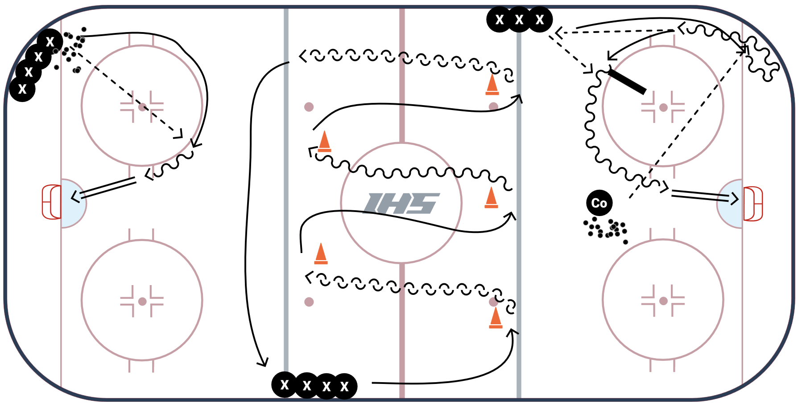
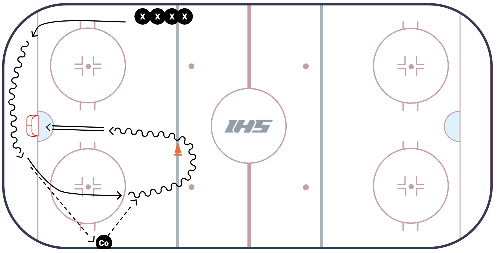

# November 5, 2026 5:40-6:40 PM

## Materials:
- bumpers
- cones
- pucks

## Practice timeline:
- Skating drills: 15 minutes
- Stations: 28 mintues
- Clean: up 2 mintes

## Skating Drills (full ice)
- Knee downs on each stride
- c-cuts right
- c-cuts left
- backwards c-cuts
